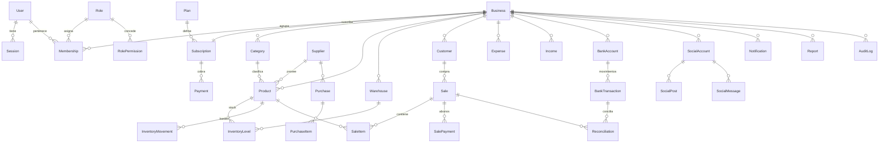

# DREAMS — Análisis y arquitectura técnica

Plataforma SaaS para que pequeños comerciantes centralicen ventas, inventario, clientes, proveedores, finanzas, bancos, redes sociales y contabilidad básica. Diseñada para crecer hacia empresas medianas y grandes.

> Este documento cubre los pasos 1–10 de la metodología pedida (análisis → seguridad) y el estado de cada fase.

---

## 1. Análisis de requisitos

| Área | Núcleo del MVP | Qué lo complica |
|---|---|---|
| Autenticación | Registro, login, recuperación, 2FA (TOTP), sesiones revocables | Rotación segura de tokens, bloqueo por intentos |
| Multi-negocio / multiusuario | Un usuario puede pertenecer a varios negocios con roles distintos | Aislamiento de datos entre negocios (multi-tenant) |
| Ventas → inventario → contabilidad | Una venta descuenta stock, actualiza cliente, cuentas por cobrar y estadísticas | Debe ser **atómico** (transacción) y reversible (anulación) |
| Contabilidad | Estado de resultados y flujo de caja **gerenciales** | No es contabilidad financiera formal (NIIF/PUC); se dice explícitamente en la interfaz |
| Bancos | Cuentas manuales, importación CSV, conciliación sugerida | Open Banking en Colombia aún es limitado y regulado |
| Redes sociales | Centro de redes, atribución de ventas por canal | Cada API tiene permisos, revisión de app y limitaciones distintas |
| Facturación | Comprobantes y órdenes internas | La factura electrónica DIAN exige habilitación, firma digital y (normalmente) proveedor tecnológico |
| IA | Asistente con preguntas sobre los propios datos | Solo datos del negocio activo; nunca datos de otros negocios |

### Problemas técnicos identificados

1. **Concurrencia de inventario**: dos ventas simultáneas del último producto. Solución: transacción con `UPDATE ... WHERE quantity >= n` (decremento condicional) y error si no hay stock.
2. **Numeración de pedidos**: consecutivo por negocio sin huecos por concurrencia → contador `nextSaleNumber` incrementado dentro de la misma transacción.
3. **Dinero**: nunca `float`. Se usa `NUMERIC(14,2)` en PostgreSQL y `decimal.js` en el backend (`apps/api/src/common/money.ts`).
4. **Doble conteo contable**: la compra de mercancía es inventario, no gasto del período. El estado de resultados usa *costo de ventas* (costo histórico guardado en cada ítem vendido) y excluye “Compra de mercancía” de los gastos operacionales; el flujo de caja sí la incluye como salida de efectivo.
5. **Aislamiento multi-tenant**: todas las tablas de negocio llevan `businessId`; un guard valida la membresía y todos los servicios filtran por ese `businessId` (nunca por un id que venga del cliente sin validar).
6. **Tokens de terceros** (bancos, redes): se cifran en reposo (AES-256-GCM) y nunca se envían al frontend.

---

## 2. APIs externas e integraciones que requieren autorización

> Regla del proyecto: **ninguna integración se presenta como funcional si no lo es.** Mientras no existan credenciales aprobadas, el sistema usa un conector *Sandbox* claramente marcado como “datos simulados”.

| Integración | API oficial | Autenticación | Requiere aprobación / cuenta | Qué se puede obtener | Qué **no** |
|---|---|---|---|---|---|
| Instagram Business | Instagram Graph API (Meta) | OAuth 2 vía Facebook Login, token de página | App en Meta for Developers, **App Review** para `instagram_basic`, `instagram_manage_comments`, `instagram_manage_insights`, `instagram_manage_messages`; cuenta Business/Creator vinculada a una Página | Publicaciones, comentarios, insights, seguidores (conteo), DMs (con permiso avanzado), publicar contenido | Lista de seguidores individuales, cuentas personales, historias de otros |
| Facebook Pages | Graph API – Pages | OAuth 2, Page Access Token | App Review (`pages_read_engagement`, `pages_manage_posts`, `pages_messaging`) + verificación del negocio | Posts, comentarios, insights, Messenger, programar posts | Datos de perfiles personales |
| WhatsApp Business | WhatsApp Business Platform (Cloud API) | Token de sistema de Meta Business | Cuenta Meta Business verificada, número dedicado; mensajes iniciados por la empresa requieren plantillas aprobadas y tienen costo | Enviar/recibir mensajes vía webhooks, plantillas | Leer chats de la app WhatsApp Business normal (del teléfono) ni el historial previo |
| TikTok Business | TikTok API for Business / Content Posting API / Display API | OAuth 2 | Registro de app y auditoría para publicar públicamente | Videos, métricas básicas, publicar | DMs (no hay API pública general) |
| YouTube | YouTube Data API v3 + Analytics API | OAuth 2 (Google) | Proyecto en Google Cloud; verificación OAuth si usa scopes sensibles; cuota diaria | Videos, comentarios, estadísticas, subir videos | Mensajes privados (no existen) |
| X / Twitter | X API v2 | OAuth 2 PKCE | Plan de pago para la mayoría de lecturas/escrituras útiles | Posts, menciones, métricas según plan | Mucho es restringido por nivel de plan |
| Bancos (Colombia) | Proveedores agregadores / Open Finance (p. ej. Belvo, Prometeo, Minka) o API corporativa del banco | OAuth / *widget* del proveedor; tokens de enlace | Contrato con el proveedor, cumplimiento de la regulación de la Superintendencia Financiera sobre finanzas abiertas; cobertura varía por banco | Movimientos, saldos (según banco y proveedor) | Pagos iniciados (requiere otra licencia); **nunca** se piden ni guardan contraseñas bancarias |
| Factura electrónica DIAN | Servicio web de facturación electrónica DIAN (UBL 2.1) | Certificado de firma digital | Habilitación como facturador ante la DIAN, set de pruebas; en la práctica se recomienda un **proveedor tecnológico autorizado** | Envío/validación de facturas, notas crédito/débito | No se integra sin habilitación y verificación técnica/legal previa |
| Pagos de suscripción | Wompi, Mercado Pago, PayU o Stripe (donde opere) | API keys + webhooks firmados | Cuenta de comercio verificada | Cobros recurrentes, estado de pagos | — |
| IA | API de un modelo de lenguaje (p. ej. Claude) | API key del servidor | Cuenta del proveedor | Respuestas en lenguaje natural sobre datos agregados | El modelo solo recibe datos del negocio activo y del usuario autorizado |

Cómo se implementan en producción: cada integración vive detrás de una **interfaz de conector** (`BankProvider`, `SocialConnector`, `EInvoiceProvider`, `PaymentGateway`). El MVP trae el conector `Sandbox`; un conector real se añade sin cambiar el resto del sistema. Los webhooks se reciben en `/api/webhooks/{proveedor}` validando la firma.

---

## 3. Arquitectura propuesta

```mermaid
flowchart LR
  U[Navegador / móvil] -->|HTTPS| WEB[Next.js 14<br/>App Router · TypeScript]
  WEB -->|/api/* proxy| API[NestJS 11<br/>REST + JWT]
  API --> PG[(PostgreSQL 16)]
  API --> R[(Redis 7<br/>rate limit · caché)]
  API --> ST[(Almacenamiento<br/>local → S3)]
  API -.conectores.-> EXT[Bancos · Meta · TikTok<br/>Google · DIAN · Pagos · IA]
  W[Workers / colas<br/>(fase futura: BullMQ)] --> PG
```

### Decisiones y justificación

| Capa | Elección | Por qué |
|---|---|---|
| Frontend | **Next.js 14 + React 18 + TypeScript + Tailwind CSS** | Rendimiento, rutas por carpeta, SSR para la página pública, ecosistema enorme. Tailwind permite un sistema de diseño propio (DREAMS) sin depender de plantillas. |
| Gráficos | Recharts | Ligero, interactivo, buena accesibilidad básica. |
| Backend | **NestJS 11 (Node.js, TypeScript)** | Arquitectura modular (un módulo por dominio), inyección de dependencias, guards/interceptors para permisos y auditoría. Mismo lenguaje que el frontend → tipos compartibles. Escala a microservicios si se necesita. |
| ORM | **Drizzle ORM** + node-postgres | Esquema en TypeScript, migraciones SQL versionadas y legibles (`apps/api/drizzle/`), consultas parametrizadas (protección contra SQL injection por defecto). Sin binarios nativos: funciona igual en Mac, Linux, Docker y entornos serverless. |
| Base de datos | **PostgreSQL 16** | Transacciones ACID (clave para ventas/inventario), `NUMERIC` exacto para dinero, JSONB para datos flexibles, particionamiento y réplicas de lectura a futuro. |
| Caché / rate limit | **Redis 7** | Límite de solicitudes compartido entre instancias; luego colas (BullMQ) para sincronizar bancos y redes. |
| Autenticación | JWT de acceso (15 min, en memoria) + refresh token opaco rotativo en cookie `httpOnly`, `Secure`, `SameSite=Strict`, guardado como hash por sesión | Revocación por sesión, “cerrar todas las sesiones”, detección de reutilización. |
| Contraseñas | Argon2id | Recomendación OWASP actual. |
| 2FA | TOTP (RFC 6238) compatible con Google Authenticator / Authy | Sin costo de SMS; secreto cifrado en BD. |
| Almacenamiento | Disco local en desarrollo, interfaz lista para S3 / Cloud Storage | Logos e imágenes de productos. |
| Hosting recomendado | **AWS** (ECS Fargate + RDS PostgreSQL + ElastiCache + S3 + CloudFront) o, para empezar barato, Railway/Render + Neon/Supabase | Todo está en contenedores Docker: se mueve entre proveedores sin reescribir. Región `us-east-1` o `sa-east-1` (São Paulo) por latencia a Colombia. |
| Logs | Logger estructurado JSON (pino-compatible) + tabla `AuditLog` para acciones de usuario | Logs técnicos van a CloudWatch/Datadog; la auditoría de negocio queda consultable en la app. |

### Multi-tenancy

Modelo de **base de datos compartida con `businessId` en cada fila**. Es el más económico para miles de negocios pequeños. Para clientes empresariales se puede migrar a *schema por tenant* o base dedicada, porque el acceso a datos está centralizado en servicios que siempre reciben el `businessId` del contexto validado.

Cada solicitud autenticada envía `X-Business-Id`. El `BusinessGuard`:
1. verifica que el usuario tenga membresía activa en ese negocio,
2. carga el rol y sus permisos,
3. deja `req.ctx = { userId, businessId, role, permissions }`.

---

## 4. Modelo de datos



Puntos clave (detalle completo en `apps/api/src/db/schema.ts`; SQL generado en `apps/api/drizzle/`):

- **Inventory** = `Warehouse` + `InventoryLevel` (stock por producto y bodega) + `InventoryMovement` (kárdex). El MVP usa una bodega “Principal”; múltiples bodegas/sucursales ya caben en el modelo.
- **SaleItem** guarda `unitCost` del momento de la venta → el costo de ventas histórico no cambia si luego cambia el precio de compra.
- **Customer** guarda acumulados (`totalSpent`, `purchaseCount`, `lastPurchaseAt`) actualizados en la misma transacción de la venta → segmentación instantánea.
- **Sale.amountPaid** vs `total` → cuentas por cobrar. **Purchase.amountPaid** y `Expense.status = PENDING` → cuentas por pagar.
- **Roles/Permisos** en tablas: los 5 roles del sistema vienen sembrados; la estructura admite roles personalizados por negocio (plan Empresarial).
- Campos `currency` en negocio y cuentas → multimoneda futura.

---

## 5. Estructura del proyecto

```
dream/
├─ docker-compose.yml        PostgreSQL, Redis, API y Web
├─ .env.example
├─ docs/ARQUITECTURA.md      este documento
├─ apps/
│  ├─ api/                   NestJS
│  │  ├─ drizzle/            migraciones SQL versionadas
│  │  ├─ test/               pruebas de humo end-to-end
│  │  └─ src/
│  │     ├─ db/              schema.ts, migrate.ts, seed.ts
│  │     ├─ common/          guards, decoradores, filtros, cifrado, auditoría
│  │     ├─ auth/            registro, login, refresh, 2FA, sesiones, recuperación
│  │     ├─ businesses/      negocio, miembros, roles, plan
│  │     ├─ catalog/         categorías y productos
│  │     ├─ inventory/       bodegas, niveles, movimientos
│  │     ├─ customers/       CRM y segmentos
│  │     ├─ suppliers/       proveedores y compras
│  │     ├─ sales/           ventas, abonos, anulación, comprobante
│  │     ├─ finance/         gastos, ingresos, contabilidad gerencial
│  │     ├─ banks/           cuentas, movimientos, conciliación, conectores
│  │     ├─ social/          centro de redes, conectores
│  │     ├─ dashboard/       indicadores y series
│  │     ├─ reports/         exportación CSV/Excel/PDF
│  │     ├─ assistant/       asistente de negocio
│  │     ├─ notifications/   notificaciones y preferencias
│  │     └─ audit/           consulta de auditoría
│  └─ web/                   Next.js
│     └─ src/
│        ├─ app/             (public) landing/login/registro · (app) módulos
│        ├─ components/      UI DREAMS: botones, tablas, tarjetas, gráficos
│        └─ lib/             cliente API, sesión, formatos
```

---

## 6. Rutas de API (prefijo `/api`)

| Módulo | Rutas |
|---|---|
| Auth | `POST auth/register` · `POST auth/login` · `POST auth/login/2fa` · `POST auth/refresh` · `POST auth/logout` · `POST auth/logout-all` · `GET auth/me` · `GET auth/sessions` · `DELETE auth/sessions/:id` · `POST auth/password/forgot` · `POST auth/password/reset` · `POST auth/password/change` · `POST auth/2fa/setup` · `POST auth/2fa/enable` · `POST auth/2fa/disable` |
| Negocios | `GET businesses` · `POST businesses` · `GET businesses/current` · `PATCH businesses/current` · `GET businesses/current/members` · `POST businesses/current/members` · `PATCH businesses/current/members/:id` · `DELETE businesses/current/members/:id` · `GET businesses/current/roles` · `GET businesses/current/plan` · `GET plans` |
| Catálogo | `GET/POST categories` · `PATCH/DELETE categories/:id` · `GET/POST products` · `GET/PATCH/DELETE products/:id` · `POST uploads/image` |
| Inventario | `GET inventory` · `GET inventory/low-stock` · `GET inventory/movements` · `POST inventory/adjustments` |
| Clientes | `GET/POST customers` · `GET/PATCH/DELETE customers/:id` (con historial y segmento) |
| Proveedores | `GET/POST suppliers` · `GET/PATCH/DELETE suppliers/:id` · `GET/POST purchases` · `POST purchases/:id/payments` |
| Ventas | `GET/POST sales` · `GET sales/:id` · `POST sales/:id/payments` · `POST sales/:id/cancel` |
| Finanzas | `GET/POST expenses` · `PATCH/DELETE expenses/:id` · `GET/POST incomes` · `DELETE incomes/:id` · `GET accounting/income-statement` · `GET accounting/cash-flow` · `GET accounting/expenses-by-category` · `GET accounting/receivables` · `GET accounting/payables` |
| Bancos | `GET/POST bank-accounts` · `GET bank-accounts/providers` · `POST bank-accounts/:id/sync` · `GET bank-transactions` · `POST bank-transactions` · `POST bank-transactions/import` · `GET reconciliations/suggestions` · `POST reconciliations/:id/accept` · `POST reconciliations/:id/reject` |
| Redes | `GET social/platforms` · `GET social/accounts` · `GET social/channel-stats` |
| Dashboard | `GET dashboard?range=today|week|month|quarter|year` |
| Reportes | `GET reports/:type?format=csv|xlsx|pdf&from=&to=` |
| Asistente | `POST assistant/ask` |
| Notificaciones | `GET notifications` · `POST notifications/:id/read` · `POST notifications/read-all` · `GET/PUT notifications/preferences` |
| Auditoría | `GET audit-logs` |

---

## 7. Roles y permisos

| Permiso | Propietario | Administrador | Vendedor | Contador | Empleado |
|---|:-:|:-:|:-:|:-:|:-:|
| `business:manage` (datos, plan) | ✓ | ✓ | | | |
| `members:manage` | ✓ | ✓ | | | |
| `products:read` | ✓ | ✓ | ✓ | ✓ | ✓ |
| `products:write` | ✓ | ✓ | | | ✓ |
| `inventory:adjust` | ✓ | ✓ | | | ✓ |
| `sales:read` / `sales:create` | ✓ | ✓ | ✓ | ✓ (solo lectura) | ✓ |
| `sales:cancel` | ✓ | ✓ | | | |
| `customers:read` / `customers:write` | ✓ | ✓ | ✓ | ✓ (lectura) | ✓ |
| `suppliers:read` / `suppliers:write` | ✓ | ✓ | | ✓ (lectura) | ✓ (lectura) |
| `finance:read` / `finance:write` | ✓ | ✓ | | ✓ | |
| `banks:read` / `banks:write` | ✓ | ✓ | | ✓ (lectura) | |
| `reports:read` | ✓ | ✓ | | ✓ | |
| `social:read` / `social:manage` | ✓ | ✓ | ✓ (lectura) | | |
| `assistant:use` | ✓ | ✓ | | ✓ | |
| `audit:read` | ✓ | ✓ | | | |

Solo el Propietario puede transferir o eliminar el negocio. El dashboard oculta tarjetas financieras a quien no tenga `finance:read` (ej. el vendedor no ve saldos ni bancos).

---

## 8. Seguridad

| Medida | Implementación |
|---|---|
| Contraseñas cifradas | Argon2id; política mínima de 8 caracteres con letras y números |
| HTTPS | Terminado en el balanceador / proxy (TLS 1.2+), HSTS vía Helmet en producción |
| Autenticación | JWT corto + refresh rotativo por sesión; detección de reutilización → revoca la sesión |
| Bloqueo | 5 intentos fallidos → bloqueo temporal de 15 min |
| SQL Injection | Drizzle (consultas parametrizadas); sin SQL dinámico con entrada del usuario |
| XSS | React escapa por defecto; sin `dangerouslySetInnerHTML`; cabeceras CSP con Helmet |
| CSRF | El API usa `Authorization: Bearer`; la única cookie (refresh) es `SameSite=Strict`, `httpOnly`, con ruta limitada a `/api/auth` y verificación de `Origin` |
| Rate limiting | Global (120 req/min por IP) y estricto en login/registro/recuperación (5–10 req/min) |
| Validación | `class-validator` con `whitelist` y `forbidNonWhitelisted` en todos los DTO |
| Permisos | `BusinessGuard` + `@RequirePermissions()` en cada endpoint |
| Auditoría | Interceptor registra toda operación de escritura (usuario, negocio, acción, IP, agente) |
| Cifrado de datos sensibles | AES-256-GCM para secreto 2FA, números de cuenta, tokens de bancos y redes (`ENCRYPTION_KEY`) |
| Mínimo privilegio | Roles por defecto restrictivos; usuario de BD de la app sin permisos de superusuario |
| Copias de seguridad | RDS: backups automáticos diarios + PITR 7–35 días; `pg_dump` programado en entornos simples (ver README) |
| Protección de datos | Cumplimiento Ley 1581 de 2012 (Habeas Data): política de tratamiento, autorización en el registro, derecho a exportar/eliminar datos |

---

## 9. Contabilidad: alcance y advertencia

DREAMS ofrece **contabilidad administrativa / gerencial**: ayuda a tomar decisiones (¿estoy ganando?, ¿en qué gasto?). **No** reemplaza la contabilidad financiera formal bajo NIIF, ni las declaraciones tributarias, ni la firma de un contador público cuando la ley la exige. La interfaz lo indica en el módulo de contabilidad y en los reportes.

Fórmulas usadas:
- Ventas netas = Σ total de ventas no anuladas − impuestos cobrados
- Costo de ventas = Σ (cantidad × costo unitario histórico)
- Utilidad bruta = Ventas netas − Costo de ventas
- Gastos operacionales = Σ gastos del período, excepto “Compra de mercancía”
- Utilidad neta estimada = Utilidad bruta + Otros ingresos − Gastos operacionales
- Margen = Utilidad neta / Ventas netas
- Flujo de caja = Entradas (abonos de ventas + otros ingresos) − Salidas (gastos pagados + pagos a proveedores)

---

## 10. Planes

| Límite | Gratuito | Básico | Profesional | Empresarial |
|---|---|---|---|---|
| Usuarios | 1 | 3 | 10 | Ilimitado |
| Productos | 100 | 1.000 | 10.000 | Ilimitado |
| Ventas / mes | 200 | 2.000 | Ilimitado | Ilimitado |
| Cuentas bancarias | 1 (manual) | 2 | 5 | Ilimitado |
| Redes conectadas | 1 | 3 | 6 | Ilimitado |
| Asistente IA | Básico | Sí | Sí | Sí + API |
| Reportes | CSV | CSV, Excel | CSV, Excel, PDF | Todo + API |

Los límites viven en la tabla `Plan.limits` (JSON) y se verifican en `PlanLimitsService` antes de crear usuarios, productos, ventas, cuentas o conexiones.

---

## 11. Estado por fases

| Fase | Estado en esta entrega |
|---|---|
| 1. Autenticación y usuarios | ✅ Funcional |
| 2. Negocio y configuración | ✅ Funcional (incluye miembros y roles) |
| 3. Dashboard | ✅ Funcional con datos reales |
| 4. Productos e inventario | ✅ Funcional |
| 5. Ventas, clientes y proveedores | ✅ Funcional |
| 6. Gastos, ingresos y contabilidad | ✅ Funcional |
| 7. Bancos y conciliación | 🟡 Cuentas manuales, registro/importación CSV de movimientos y motor de conciliación funcionales; conexión bancaria real pendiente de proveedor (conector Sandbox con datos simulados) |
| 8. Redes sociales | 🟡 Centro de redes con requisitos reales por plataforma y atribución de ventas por canal; conexión OAuth pendiente de apps aprobadas |
| 9. Reportes | 🟡 CSV y Excel funcionales; PDF del estado de resultados |
| 10. Asistente IA | 🟡 Responde las preguntas frecuentes con cálculos exactos sobre los datos del negocio; listo para conectar un modelo de lenguaje |
| 11. Suscripciones y pagos | 🟡 Planes y límites aplicados; pasarela de pago pendiente |
| 12. Seguridad, pruebas y optimización | 🟡 Medidas base implementadas; pruebas unitarias del núcleo y pruebas de humo end-to-end (`apps/api/test`); faltan pruebas de carga y pentest |
